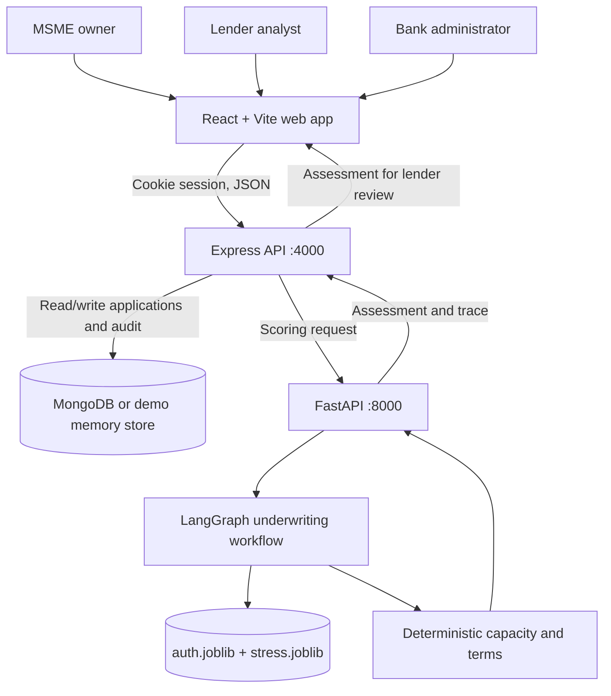
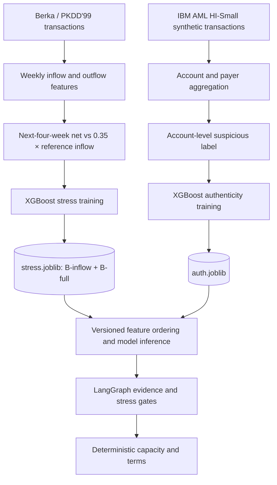

# ZeroCIBIL

ZeroCIBIL is a two-sided underwriting demo for credit-invisible micro, small, and medium businesses (MSMEs). Shop owners submit an application and financial evidence; lenders review transaction quality, model signals, cash-flow capacity, and suggested repayment terms. The repository includes a React web app, an Express application API, a Python scoring service, trained research models, and a LangGraph underwriting workflow.

This is a demo and decision-support system. It uses synthetic or simulated product evidence, does not connect to live bank rails, and does not disburse loans. A lender remains responsible for the final credit decision.

## Contents

- [Product and capabilities](#product-and-capabilities)
- [Technology stack](#technology-stack)
- [System architecture](#system-architecture)
- [ML model architecture](#ml-model-architecture)
- [Agent workflow](#agent-workflow)
- [Repository map](#repository-map)
- [Run locally](#run-locally)
- [Configuration and deployment](#configuration-and-deployment)
- [Checks](#checks)
- [Limitations](#limitations)
- [Further documentation](#further-documentation)

## Product and capabilities

- Owner, bank, and lender portals with role-based sessions.
- Shop application submission, simulated rails, evidence review, and lender queues.
- Transaction cash-flow features, authenticity and stress signals, deterministic capacity calculations, and indicative repayment terms.
- Decision explanations, decision traces, audit records, and lender overrides.
- Scenario scoring that adjusts a copy of the cash flows and marks its result as scenario-only.
- Optional Setu Account Aggregator sandbox flow using mock FI data.

## Technology stack

| Area | Technologies |
|---|---|
| Web | React 19, React Router 7, Vite 6, native CSS |
| Application API | Node.js, Express 4, MongoDB Node driver, cookie-session |
| Scoring API | Python 3, FastAPI, Pydantic, Uvicorn |
| Agent workflow | LangGraph, typed underwriting state, deterministic Python tools |
| Model training and inference | Jupyter, pandas, NumPy, scikit-learn, XGBoost, joblib |
| Observability | LangSmith tracing when configured |
| Storage | MongoDB; process-local in-memory fallback for demo mode |
| Tests and build | Node built-in test runner, pytest, Vite build |

The web development server proxies `/api` to the Express API. The API calls the Python scorer using `SCORE_URL`; MongoDB is the configured durable store.

## System architecture



The Express API owns user sessions, roles, application records, evidence records, idempotency, and lender actions. The Python service validates scoring inputs, runs model and policy code, and returns structured results. Production scoring requests require the configured scorer key. The LangGraph path collects validation, evidence, model, policy, explanation, and audit details; failures that prevent safe completion route to review or fallback handling.

## ML model architecture

Two saved XGBoost model families are loaded from `ml/models/`:

| Model | Training data and target | Feature variants | Intended interpretation |
|---|---|---|---|
| Authenticity (`auth.joblib`) | IBM AML HI-Small; account is labeled suspicious if it participates in a laundering-labeled transaction | Five account-level features: payer concentration, round-amount ratio, history, and empty-then-spike behavior | Evidence review signal; raw score is uncalibrated and reflects synthetic generator patterns |
| Stress (`stress.joblib`) | Berka/PKDD'99; proxy label compares next-four-week net cash flow with a reference EMI derived from prior inflow | B-inflow (six features) and B-full (adds outflow ratio and unique payer count) | Cash-flow stress signal against a proxy target, not observed loan default |



Training notebooks are in `ml/notebooks/`; model metadata, feature order, and thresholds are in `ml/models/meta.json`. Holdout reports and model cards are in `ml/reports/`. Feature definitions and source-data requirements are documented in [USER_TRANSACTION_TO_MODEL_INPUT_SPEC.md](USER_TRANSACTION_TO_MODEL_INPUT_SPEC.md).

**Interpret scores carefully:** neither model is calibrated to Indian MSME or UPI outcomes. The stress target is a constructed proxy, and IBM AML is synthetic. Model outputs are review signals; identity checks, verified-rail checks, and affordability/capacity logic are deterministic policy inputs. The FastAPI legacy `/internal/score` route attaches trained scores as metadata while its verdict is produced by heuristic policy. The LangGraph path separately loads trained scores for its gates.

## Agent workflow

The active workflow is `Agentic/graph.py`. It uses shared state and explicit graph routing:

1. Validate schema, application shape, and rails. Applications with no verified rail return an unverified evidence outcome.
2. If documents are present, attempt supported bank-statement intake. Extracted statement rows are marked synthetic; arbitrary owner uploads do not become verified rails.
3. Normalize cash flows, check row quality, build weekly and model features, reconcile evidence, and select B-full when a verified AA bank rail is available or B-inflow otherwise.
4. Score authenticity and determine whether evidence passes, needs more information, or needs review.
5. For a passing authenticity gate, score stress and calculate capacity. Apply versioned offer policy to produce terms or a review outcome.
6. Reconstruct an explanation and decision trace from recorded evidence. Validation, data-quality, and model-scoring failures route through fail-closed handling.

`POST /internal/agent` invokes the graph. If graph execution raises, the service falls back to ordinary scoring and returns a workflow trace marking agent unavailability. LangSmith tracing is optional and configured through environment variables; see [langsmith-observability.md](docs/langsmith-observability.md).

## Repository map

```text
apps/
  web/       React owner, bank, and lender interfaces
  api/       Express API, access control, persistence, seed data
Agentic/     LangGraph orchestration, state, agents, and tools
zerocibil/   Shared workflow modules imported by the scorer
ml/          FastAPI service, model inference, notebooks, artifacts, reports
docs/        Architecture, model workflow, and observability documentation
```

## Run locally

Requirements: Node.js/npm, Python, and MongoDB. The API reads the root `.env`, defaults to `mongodb://127.0.0.1:27017/zerocibil`, and listens on port 4000. Vite serves the web app on port 5173 and proxies `/api` to the API. Use three terminals from the repository root.

### 1. Start the scoring service

```powershell
cd ml
python -m venv .venv
.venv\Scripts\Activate.ps1
pip install -r requirements.txt
uvicorn service:app --host 127.0.0.1 --port 8000
```

### 2. Start the application API

```powershell
cd apps/api
npm ci
npm run dev
```

### 3. Start the web app

```powershell
cd apps/web
npm ci
npm run dev
```

Open `http://localhost:5173`. Demo users are `owner@demo`, `lender@demo`, and `bank@demo`. The API seeds demo records at startup. From an empty lender queue, select **Seed and score demo applications** to create and assess demo cases.

For temporary in-memory API storage, set `MONGODB_URI=memory` in the root `.env`; data is cleared when the API process stops. To load seed data explicitly, run `npm run seed` from `apps/api`.

## Configuration and deployment

For local development, copy `.env.example` to `.env` and set only the values needed for your flow. MongoDB is optional when using `MONGODB_URI=memory`. The scorer binds to loopback locally and may omit `SCORER_API_KEY` outside production.

For production, configure `APP_ENV=production`, a MongoDB replica-set or sharded-cluster URI (TLS for remote databases), a session secret of at least 32 characters, and the same `SCORER_API_KEY` of at least 32 characters in the API and scorer environments. Set `CORS_ORIGIN` to the HTTPS web origin and use HTTPS for remote `SCORE_URL`. The API expects exactly one trusted reverse-proxy hop. Production application and lender-action writes use Mongo transactions. Use shared rate limiting and centralized log retention for multi-instance deployments.

### Setu Account Aggregator sandbox

Setu integration is sandbox-only and uses mock data. Create an AA FIU sandbox product in [Setu Bridge](https://bridge.setu.co/) and set `SETU_CLIENT_ID`, `SETU_CLIENT_SECRET`, and `SETU_PRODUCT_INSTANCE_ID` in the root `.env`. Configure the consent return URL as `https://<your-web-origin>/owner/aa/return`. The hosted flow uses Setu FIP mock accounts; Setu FIP-2 uses OTP `123456`. Optional webhook authentication uses `SETU_AA_WEBHOOK_TOKEN`. See [sdk-spec.md](sdk-spec.md) for the integration contract. Keep `SESSION_SECRET`/`JWT_SECRET` stable while encrypted sandbox evidence is retained; a live deployment would require managed key storage.

The API can flag dated verified activity older than 90 days for lender review. Configure `EVIDENCE_REVIEW_AGE_DAYS` and `EVIDENCE_FRESHNESS_VERSION` to change and version this review cue. It does not change scores, terms, or assessment eligibility; undated evidence remains unknown.

## Checks

Run checks from the corresponding package directory:

```powershell
# apps/web
npm test
npm run build

# apps/api
npm test

# Python service and model code
cd ../../ml
python -m pytest
```

The Python tests use the pinned dependencies in `ml/requirements.txt`. Model training requires the source datasets and is run separately in Jupyter; inference uses the checked-in joblib artifacts.

## Limitations

- Product transactions, rails, statements, and bank-review examples are synthetic or simulated. Setu uses sandbox data; no live bank, UPI, AA, or GST provider is connected.
- Model A learns patterns from synthetic IBM AML transactions. Model B uses a derived Berka cash-flow proxy target. Neither is validated for Indian MSME lending outcomes.
- Raw model scores are uncalibrated and are not default or fraud probabilities.
- The FastAPI heuristic-policy route and LangGraph model-driven gates are different execution paths; see the workflow document for the current behavior.
- Uploaded PDFs are supporting evidence; they do not count as verified operational rails.
- This application does not issue credit agreements or disburse loans. Lender review is required.

## Further documentation

- [Technical architecture and full service flow](docs/technical-architecture.md)
- [ML and agent workflow diagram](docs/ml-agent-workflow.md)
- [Model training decisions](ml/TRAINING_DECISIONS.md)
- [Transaction-to-model feature contract](ml/USER_TRANSACTION_TO_MODEL_INPUT_SPEC.md)
- [Backend implementation notes](backend.md)
- [Frontend implementation notes](frontend.md)
- [Feature inventory and remaining work](features-spec.md)
- [Setu sandbox integration contract](sdk-spec.md)
- [LangSmith observability](docs/langsmith-observability.md)
- [Visual design system](design.md)
