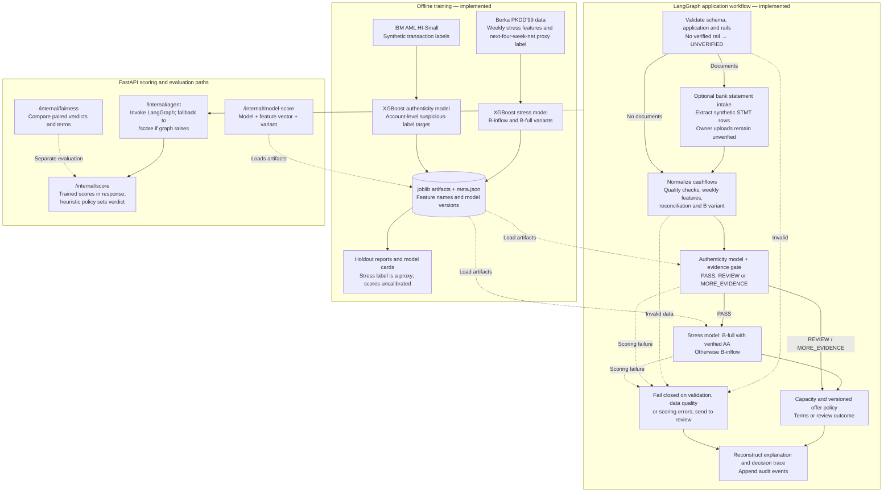

# ML and agent workflow

This document describes the implemented model training artifacts, LangGraph underwriting flow, and FastAPI scoring routes.
### Slide B — ML training and agent workflow

Training notebooks, saved artifacts and LangGraph are implemented. Berka stress labels are a proxy and IBM AML is synthetic. FastAPI heuristic-policy scoring and LangGraph model-driven gates are distinct paths.## Implementation notes

- Stress model artifacts are trained from Berka PKDD data using a next-four-week-net proxy target. The inference model supports `B-inflow` and `B-full` feature variants.
- The authenticity artifact is trained from IBM AML HI-Small account-level labels, which are synthetic.
- Model probabilities are not calibrated for Indian MSME or UPI outcomes.
- The LangGraph path applies the trained scores to authenticity and stress gates, then calculates capacity and policy terms.
- The FastAPI `/internal/score` path returns trained model scores as metadata while its verdict still uses heuristic policy. `/internal/agent` invokes the graph and falls back to ordinary scoring if graph execution raises.
- The lender remains responsible for the final credit decision.

## Code references

- `Agentic/graph.py` and `Agentic/agents/`
- `Agentic/tools/scoring.py` and `Agentic/tools/finance.py`
- `ml/artifacts.py`, `ml/model_features.py`, and `ml/models/meta.json`
- `ml/notebooks/` and `ml/reports/`

