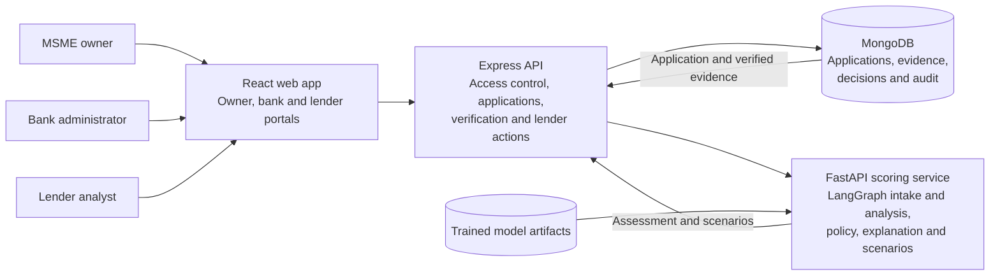
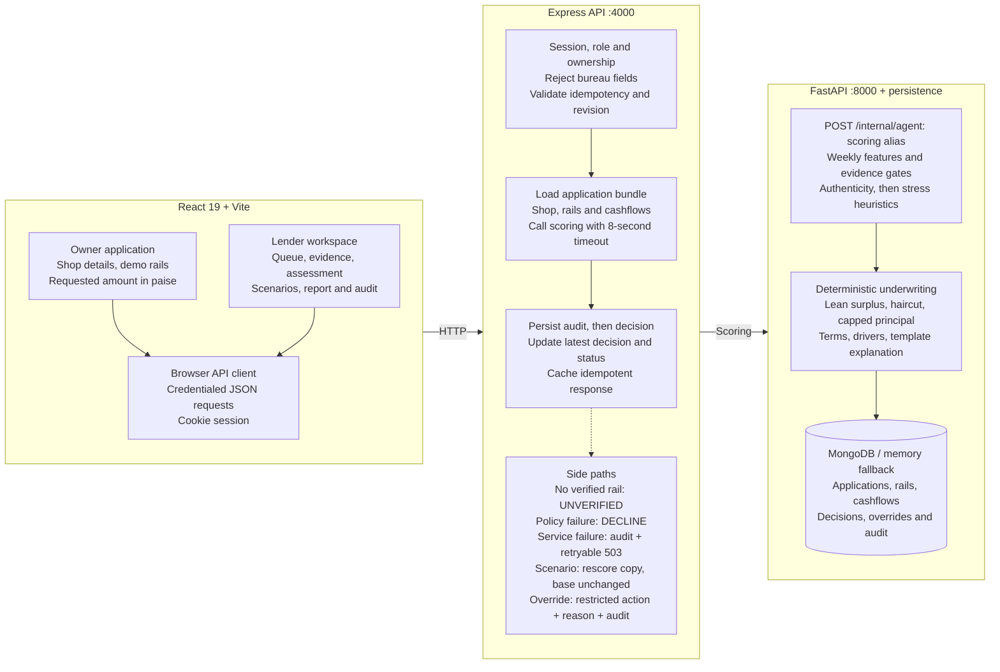
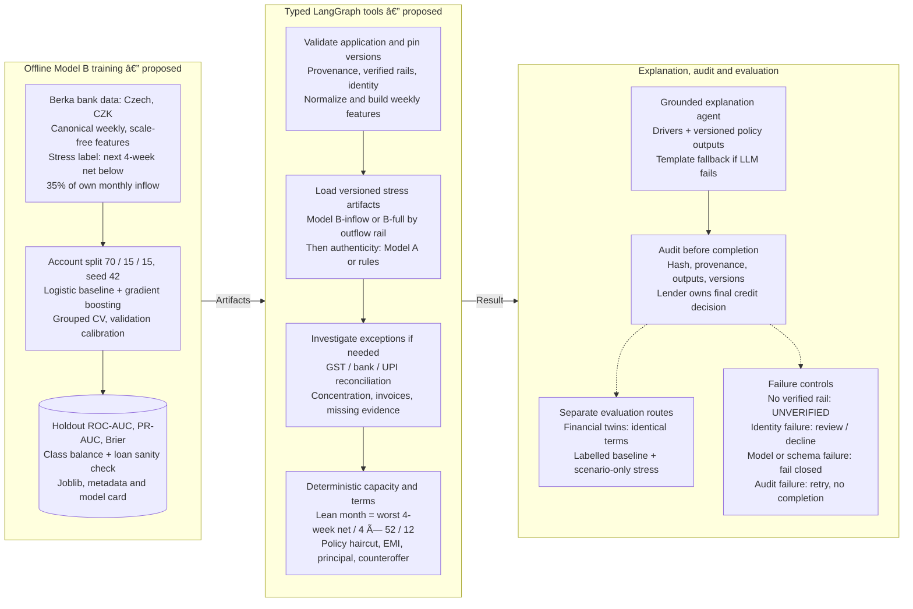
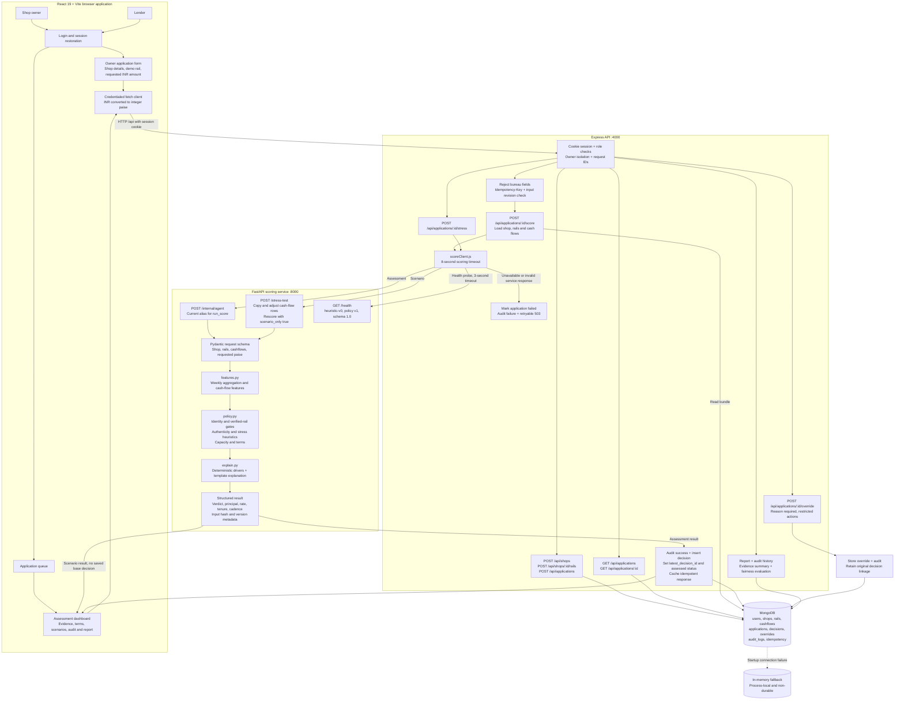
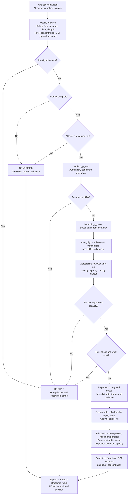
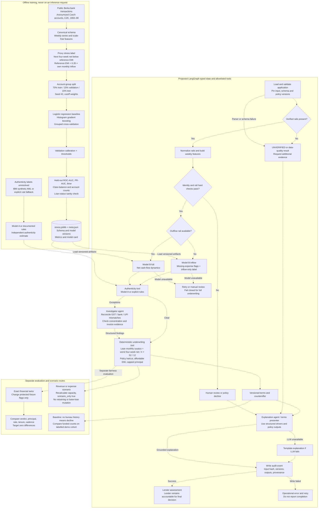

# ZeroCIBIL technical architecture

## Full product architecture

The bank account, transaction, rail, and statement data in this repository are synthetic. The trained authenticity and stress scores are exposed by the scoring service, while the policy verdict still uses versioned heuristics pending domain calibration. The lender makes the final credit decision; the scenario result does not overwrite the base assessment. MongoDB is the durable store when configured, with a process-local memory fallback for demos.

Source: the current React, Express and Python code, and `spec-new.md`. The full product diagram above reflects the current service boundaries. The older diagrams below retain their original prototype and proposed-target captions. Demo rail verification is simulated, not a production UPI, bank or Account Aggregator connection.

## Slide-ready versions

Use one diagram per 16:9 slide. The Mermaid versions run left to right in three columns. The exported images use a fixed 1920 × 1080 landscape canvas with three horizontal lanes. The full diagrams remain below for reference. Keep the caption under each diagram on its slide.

Landscape exports for PowerPoint (1920 × 1080):

- [Application and service flow — PNG](../output/architecture/application-service-flow-landscape.png) · [SVG](../output/architecture/application-service-flow-landscape.svg)
- [Proposed training and agents — PNG](../output/architecture/training-agent-architecture-landscape.png) · [SVG](../output/architecture/training-agent-architecture-landscape.svg)

SVG keeps lines and text sharp when resized. Each numbered lane continues left to right; error handling and evaluation boxes summarize separate branches.

### Slide A — Application and service flow

Implemented prototype with simulated evidence and heuristic-v0.

### Slide B — Proposed training and agent architecture

Proposed target. Berka proxy data, trained models and LangGraph are not implemented claims.

## 1. Application and service flow — full detail

## 2. Current scoring and underwriting decisions

This is the implemented policy order, including early returns. It differs from the target spec: low authenticity currently stops evaluation before the stress heuristic runs.

## 3. Proposed training and agent architecture

Everything in this diagram is a target from `spec-new.md`, except the shared feature and deterministic policy components that already have prototype implementations. No trained-model accuracy or live MSME outcome is asserted.

## Boundaries and implementation gaps

- Browser route guards support navigation; the Express API enforces sessions, roles and ownership on its routes.
- FastAPI currently exposes scoring routes without its own authentication. Internal network restriction or service authentication is a deployment requirement, not an implemented control shown here.
- MongoDB failure currently falls back to non-durable memory. Audit and decision writes are sequential, not a database transaction.
- The current stress endpoint adjusts every supplied cash-flow row. A lean-window-only adjustment is a proposed refinement, not current behavior.
- The current service labels results synthetic and uses `heuristic-v0`. Trained B-inflow/B-full artifacts, calibration and LangGraph agents remain proposed.
- Protected attributes belong only in fairness fixtures. Agents must never change probabilities, thresholds, haircuts or credit decisions.
- There is no live disbursal, production AA/GST integration or validated Indian MSME default prediction in this architecture.

## Code references

- `apps/web/src/data/api.js`, `apps/web/src/pages/OwnerApply.jsx`, `apps/web/src/pages/LenderDesk.jsx`
- `apps/api/src/createApp.js`, `apps/api/src/scoreClient.js`, `apps/api/src/store.js`, `apps/api/src/index.js`
- `ml/service.py`, `ml/features.py`, `ml/policy.py`, `ml/explain.py`, `ml/models/meta.json`
- `spec-new.md`, sections 3–8, 10–18 and 22–24
